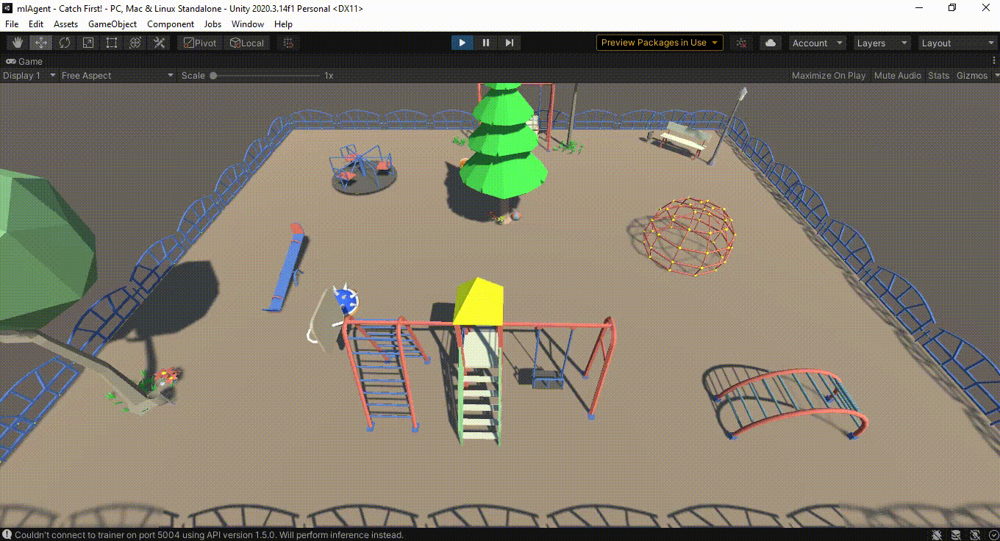
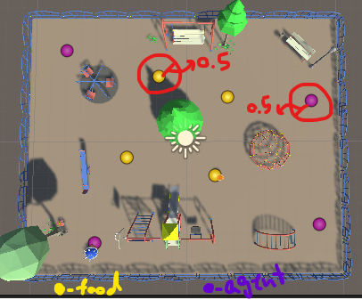

# Catch First!

A search-and-find zero-player game using ML-Agents.
Huge thanks to the ML-Agents package devs and [Code Monkey](https://www.youtube.com/@CodeMonkeyUnity) tutorials for teaching how to train an agent on a custom map to catch goals.

# Positions of Agent and Goal

The agent and goal have four different positions that are randomly chosen, but each waypoint position has a radius (0.5) within which the positions of the agent and goal are randomly selected.

# Neural Network Model

For training this neural network model for the agent, I used a basic configuration and trained it for 3.5 million steps. The best mean reward achieved was 0.993.  
You can see more information in the charts below.

# Installation
- ML-Agents: 0.29.0
 ml-agents-envs: 0.28.0
 Communicator API: 1.5.0
 PyTorch: 1.7.0+cu110
 Unity: 2020.3.14

# Future Plans

1. I want to turn this into a "Catch First" game and pit the player against the agent.
 2. I want to make the agent smarter and increase its routing probability.

 
 
I would be happy to hear any comments or suggestions you have for this project.
